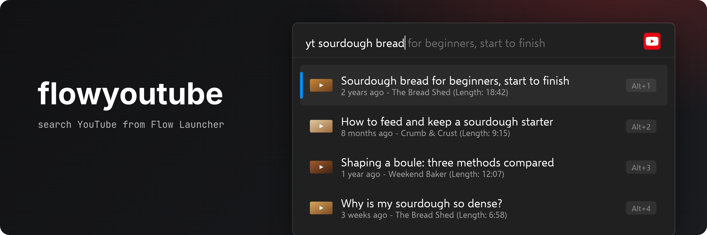

<!-- generated by readwright from docs/README.md.j2; edit the template, not this file -->


# FlowYouTube

Search YouTube from Flow Launcher.

[](https://github.com/Garulf/FlowYouTube/actions/workflows/tests.yml) [](https://github.com/Garulf/FlowYouTube/releases/latest) [](https://github.com/Garulf/FlowYouTube/releases/latest)

[](https://www.buymeacoffee.com/garulf) [](https://github.com/sponsors/Garulf)

## Features

* **Search without leaving the keyboard.** Results show the title, channel, upload date and length.
* **Thumbnails.** Each result shows the video's thumbnail. Turn them off in the settings if you prefer the plain icon.
* **Your language and region.** Pick the YouTube language and region the results should come from.
* **Open it your way.** Open the video in your browser, copy its link, or send it to a player such as mpv or PotPlayer.
* **No API key.** Nothing to sign up for or configure.

## Usage

Type `yt` followed by what you're looking for, then press `Enter` to open the video in your browser:

```
yt sourdough bread
```


Open the context menu (`Shift+Enter` or right-click) on a result to:

* **Open in browser**
* **Open with** the program set in the settings, if any
* **Copy to clipboard** to copy the video's link. `Ctrl+C` on a result does the same.

## Installation

### Flow Launcher

In Flow Launcher, type:

```
pm install FlowYouTube
```


### Manual installation

Download `FlowYouTube-<version>.zip` from the [latest release](https://github.com/Garulf/FlowYouTube/releases/latest) and unzip it into
`%appdata%\FlowLauncher\Plugins`, then restart Flow Launcher.

Pre-releases of the next version are published from the open release PR on the
[releases page](https://github.com/Garulf/FlowYouTube/releases) for testing. Flow Launcher won't offer them as updates.

## Configuration

Open **Settings → Plugins → FlowYouTube** in Flow Launcher:

| Setting | Default | Description |
| --- | --- | --- |
| Max results | `10` | How many videos to show, from 5 to 30 |
| Download Thumbnails | on | Show each video's thumbnail instead of the plugin icon |
| Language | Default | The YouTube interface language, which also sets the language of dates |
| Region | Default | The country YouTube ranks results for |
| Program Path | | A program to open videos with from the context menu, for example `C:\Program Files\mpv\mpv.exe` |
| Program Arguments | `{url}` | Arguments for that program. `{url}` is replaced by the video's link, e.g. `/add {url}` |

## Requirements

* Flow Launcher 1.17.0 or newer
* Python 3.8 or newer, which Flow Launcher can install for you

## Changelog

See [CHANGELOG.md](CHANGELOG.md) for the full history.
